<h1 align="center">Hi there, I'm Md. Ismile Hossain 👋</h1>

  
  
  

  

I am a Software Engineer passionate about building clean, scalable, and efficient solutions for real-world problems. I enjoy working with modern web technologies, exploring new tools, and creating software that delivers both performance and user value.

---

### 🛠️ Tech Stack

  
  
  
  
  
  
  
  
  

- Languages: PHP, JavaScript, TypeScript
- Frameworks: Laravel, Node.js, Express.js, React
- Databases: MySQL, MongoDB
- Concepts: REST APIs, MVC, Git, GitHub, Clean Architecture

---

### 📈 GitHub Stats

  
  

  

---

### 📫 Connect With Me

- Email: ismile.cse.mist@gmail.com
- LinkedIn: https://www.linkedin.com/in/md-ismile-hossain-86b066202/
- GitHub: https://github.com/Ismile-Hossain

---

⭐️ Thanks for visiting my profile!
